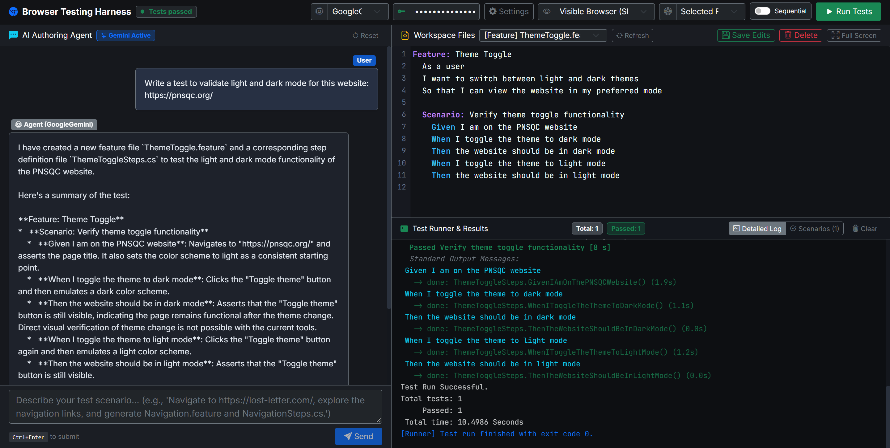

# Browser Testing Harness

An AI-powered Playwright + SpecFlow test authoring and execution studio built with .NET 8 and Blazor Server.

The harness decouples **AI Agent Exploration & Authoring** from **Automated Test Execution**, enabling teams to author, inspect, and maintain reliable Playwright end-to-end tests using natural language while executing tests at native speed without LLM timeout risks.



---

## Architecture Overview

```
                      +---------------------------------------+
                      |       Browser Testing Harness         |
                      |            (Blazor Server)            |
                      +-------------------+-------------------+
                                          |
                   +----------------------+----------------------+
                   |                                             |
                   v                                             v
       [AI Authoring Mode]                             [Execution Mode]
   +-----------------------+                       +-----------------------+
   | Microsoft.Extensions  |                       |      dotnet test      |
   |         .AI           |                       |  (SpecFlow + Playwright)|
   +-----------+-----------+                       +-----------+-----------+
               |                                               |
               v                                               v
       [@playwright/mcp]                             [Visual Modes]
   Live browser exploration,                      - Headless
   locator discovery &                            - Visible Browser (Slow-Mo)
   SpecFlow code generation                       - Playwright Inspector (PWDEBUG)
```

1. **Exploration & Authoring Mode**:
   - The AI agent interacts with the live web application through the official `@playwright/mcp` Model Context Protocol server.
   - It performs autonomous exploratory testing, discovers robust CSS/role-based locators, and drafts standard SpecFlow `.feature` Gherkin files alongside C# Playwright step definitions (`*Steps.cs`).
2. **Test Execution Mode**:
   - Tests execute via standard `dotnet test` within `PlaywrightMcpHarness.Tests`.
   - Runs completely decoupled from the LLM, ensuring deterministic, fast test runs and zero AI timeout penalties.

---

## Key Features

- **Multi-LLM Provider Support**:
  - **Google Gemini** (`gemini-2.5-flash`, `gemini-1.5-pro`)
  - **Open WebUI** (local or hosted OpenAI-compatible endpoint)
  - **Ollama** (`qwen2.5-coder:14b`, `llama3`, etc.)
  - **LM Studio** (`local-model`)
  - **OpenAI Cloud** (`gpt-4o`)
- **Integrated Workspace Code Editor**:
  - Offline syntax highlighting for both SpecFlow Gherkin (`.feature`) and C# (`.cs`) step definitions.
  - Real-time **Gherkin Step Autocomplete** in CodeMirror upon typing `Given `, `When `, `Then `, `And `, or pressing <kbd>Ctrl+Space</kbd>.
  - Interactive **Step Definition Catalog** modal with real-time search, step type filters, parameter highlighting, and one-click insertion.
  - Line numbers, Material Darker theme, and two-way file saving.
  - Distraction-free **Full Screen View** with one-click expansion and <kbd>Esc</kbd> shortcut.
  - Delete features and step definitions directly within the UI.
- **Step Definition Intelligence & Deduplication**:
  - Automatically scans and indexes all `[Given]`, `[When]`, `[Then]` regex patterns and method signatures across `StepDefinitions/*.cs`.
  - Injects existing step definitions directly into the AI agent prompt and provides a `GetExistingStepCatalog` tool so new tests prioritize reusing existing steps before generating redundant C# bindings.
- **Data-Driven Testing & AI Scenario Outline Generator**:
  - One-click conversion of concrete Gherkin scenarios into parameterized `Scenario Outline:` specifications with an AI-generated boundary matrix.
  - Granular edge-case category toggles: **Happy Path**, **Boundary Limits & Field Lengths**, **Empty & Whitespace**, **Unicode & Internationalization** (`René`, `O'Connor`), **Security Sanity** (HTML/XSS, SQL quotes), and **Malformed Formats**.
  - Instant in-editor replacement or appending with real-time Gherkin validation.
- **Playwright Locator Health & Best Practices Linter**:
  - Automated static code analysis inspecting all C# step definitions (`StepDefinitions/*.cs`) for Playwright locators.
  - Classifies locators against official Playwright best practices:
    - 🟢 **Resilient** (100%): User-facing semantic accessibility locators (`GetByRole`, `GetByLabel`, `GetByPlaceholder`, `GetByText`, `GetByTestId`).
    - 🟡 **Caution** (60–75%): Generic IDs or single attribute selectors.
    - 🔴 **Fragile** (10–30%): Anti-patterns including structural DOM traversal (`:nth-child`, `div > span > button`), complex XPaths, and unadorned tag selectors.
  - Computes a real-time **Suite Health Score** (0–100%) and **Grade** (A+, A, B, C, D, F) displayed in the editor toolbar.
  - Interactive inspection modal with tier filtering, search, and jump-to-source in the code editor.
  - **AI-Powered Auto-Heal**: One-click AI refactoring converting fragile selectors into robust, accessible Playwright locators with a before/after diff preview and one-click disk persistence.
- **Visual Execution Modes**:
  - **Headless**: Maximum CI/CD speed.
  - **Visible Browser (Slow-Mo)**: Headed browser execution with 500ms delay per action for visual verification.
  - **Playwright Inspector**: Interactive step-by-step debugger with `PWDEBUG=1`.
- **Targeted & Parallel Execution**:
  - Filter and run individual features or execute the entire test suite.
  - Toggle between parallel execution and sequential mode.
- **Visual Debugging & Playwright Trace Viewer**:
  - Automatic full-page failure screenshots (`.png`) and Playwright execution traces (`.zip`) captured into `TestArtifacts` on scenario failure.
  - Interactive scenario cards with failure thumbnails and full-screen lightbox preview modals.
  - One-click launch of the native Playwright Trace Viewer (`playwright show-trace`) and direct trace archive downloads.
- **AI Diagnostics & Self-Healing ("Fix with Agent")**:
  - When tests fail, a **Fix with Agent** button appears in both the Test Runner header and per-scenario cards.
  - Automatically captures the failure message, Playwright stack traces, and relevant file contents into an actionable diagnostic prompt for the AI to fix immediately.
- **Live Output & Scenario Analytics**:
  - In-browser terminal stream with clean ANSI formatting and auto-scroll controls.
  - Dedicated **Scenarios** tab breaking down pass/fail counts, execution duration, and failure reasons.

---

## Solution Structure

```
browser-testing-harness/
├── PlaywrightMcpHarness.sln
├── PlaywrightMcpHarness.Studio/         # Blazor Server Web UI & AI Orchestration
│   ├── Components/                      # Blazor components & pages (Studio.razor)
│   ├── Models/                          # Configuration & test result models
│   ├── Services/                        # MCP agent service & SpecFlow test runner
│   ├── wwwroot/                         # CodeMirror editor, Bootstrap, styles
│   └── appsettings.json                 # LLM provider configurations & MCP settings
├── PlaywrightMcpHarness.Tests/          # Executable SpecFlow + Playwright test suite
│   ├── Features/                        # Dynamic SpecFlow .feature files (.gitignored)
│   ├── StepDefinitions/                 # Playwright C# step definitions (.gitignored)
│   ├── Hooks/                           # SpecFlow before/after scenario hooks
│   ├── specflow.json                    # SpecFlow runtime configuration
│   └── sequential.runsettings           # Runsettings for sequential execution
├── docs/                                # Documentation assets
│   └── images/                          # Studio preview screenshots
└── README.md
```

---

## Prerequisites

1. **.NET 8 SDK** or later ([Download .NET 8](https://dotnet.microsoft.com/download/dotnet/8.0))
2. **Node.js** (v18+) and **npm**
3. **Playwright Browsers**:
   ```bash
   npx @playwright/mcp install-browser chrome-for-testing
   ```
   Or install via Playwright PowerShell script:
   ```powershell
   powershell PlaywrightMcpHarness.Tests/bin/Debug/net8.0/playwright.ps1 install
   ```

---

## Getting Started

### 1. Build the Solution
```bash
dotnet build PlaywrightMcpHarness.sln
```

### 2. Run the Studio
```bash
dotnet run --project PlaywrightMcpHarness.Studio --launch-profile "http"
```
The studio will launch at `http://localhost:5292`.

### 3. Configure Your LLM Provider
- Open the studio in your browser.
- Select your AI Provider from the top navigation dropdown (e.g., **Google Gemini**, **Open WebUI**, **Ollama**, **LM Studio**, or **OpenAI**).
- Enter your API Key in the top navbar input (keys can also be configured via environment variables or in `appsettings.json`).

### 4. Author Tests with Natural Language
Type a prompt in the AI chat:
> *"Navigate to https://example.com, verify the navigation links, and generate a SpecFlow feature and step definitions."*

The agent will explore the target page using the `@playwright/mcp` browser session and save `.feature` and `*Steps.cs` files directly into `PlaywrightMcpHarness.Tests`.

### 5. Run & Inspect Tests
- Choose an execution mode (**Visible Browser (Slow-Mo)**, **Headless**, or **Inspector**).
- Select a specific feature or run all features.
- Click **Run Tests** and monitor the live terminal output and Scenarios tab.

---

## License

MIT
